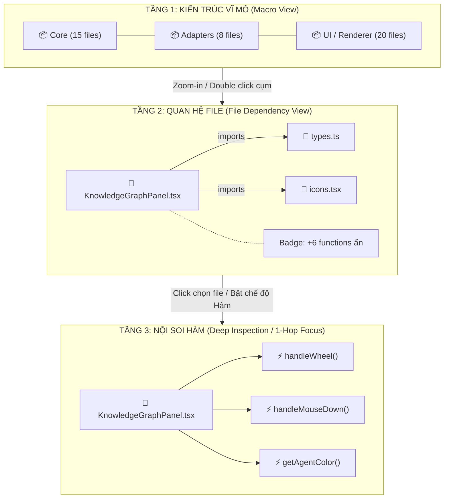

# ĐỀ XUẤT CẢI TIẾN GIAO DIỆN & TƯƠNG TÁC: CODEBASE KNOWLEDGE GRAPH
## Khắc phục Hiện tượng "Ma trận Hỗn loạn" (Hairball Matrix) khi Dự án Lớn & Nhiều Hàm
**Dự án:** Synapse OS (v2 Knowledge Graph Edition)  
**Tài liệu chuyển giao:** Gửi Đội ngũ Thiết kế UI/UX (Figma) & Đội ngũ Kỹ thuật (Frontend/Backend)  
**Ngày lập:** 10/11/2026  

---

## 1. Phân Tích Thực Trạng & Tử Huyệt Giao Diện Hiện Tại

Dựa trên ảnh chụp thực tế từ hệ thống khi mở dự án thật (**118 Nodes / 261 Edges**):

```
       [ 118 NODES / 261 EDGES ]
               ╭───────╮
         ╭─────│ Ma trận│─────╮
         │     │ chữ đè │     │  <-- 118 labels chữ cyan/trắng đè khít lên nhau
         │     │ lên chữ│     │  <-- 261 đường nối đan chéo xuyên tâm qua vòng tròn
         ╰─────│ cực dày│─────╯
               ╰───────╯
```

### 4 "Tử huyệt" khiến người dùng cảm thấy "bất lực":
1. **Bố cục vòng tròn đơn lẻ (Single Circle / Radial Layout)**:
   - Toàn bộ 118 nodes (từ file cấu hình, file mã nguồn, file test đến các hàm con) đều bị rải đều trên một đường elip/vòng tròn có bán kính cố định ~200px.
   - Mọi cạnh nối giữa các node đối xứng đều chạy xuyên qua tâm đĩa tròn, tạo thành một "búi tóc rối" (Hairball) dày đặc ở giữa.
2. **Xung đột nhãn chữ (Label Overlapping & Text Collision)**:
   - 100% tên node (`ensureLockOwnership()`, `createAgentCLIAdapter()`, `Sidebar.tsx`, v.v.) được hiển thị cùng lúc bằng font chữ lớn.
   - Khi mật độ node cao, các dòng chữ đè trực tiếp lên nhau, người dùng hoàn toàn không thể đọc được bất kỳ tên file hay tên hàm nào.
3. **Mất hoàn toàn tính phân cấp (Zero Hierarchy / Flat Model)**:
   - Một hàm nhỏ nội bộ (`cut_highlights()`) có cùng trọng số hiển thị với một module trung tâm (`KnowledgeGraphPanel.tsx`) hay một file cấu hình (`package.json`).
   - Người dùng không thể phân biệt đâu là kiến trúc tổng thể, đâu là chi tiết cài đặt.
4. **Thiếu bộ lọc ngữ cảnh (No Contextual Filtering)**:
   - Người dùng không có nút chọn nhanh để: "Chỉ xem các file đang chạy", "Ẩn toàn bộ hàm con", "Chỉ xem các liên kết của 1 file được chọn (1-hop)".

---

## 2. Mô Hình Giải Pháp Cốt Lõi: "Từ Vĩ Mô Đến Vi Mô"

Để biến "ma trận bất lực" thành một công cụ hỗ trợ tư duy kiến trúc và theo dõi Agent đắc lực, giao diện cần chuyển dịch từ **Mô hình Phẳng (Flat Graph)** sang **Mô hình Phân Cấp Đa Tầng (Hierarchical Multi-Level Graph)**:



---

## 3. Đặc Tả 5 Cải Tiến Đột Phá Cho Đội Ngũ UI/UX Designer

### Giải pháp 1: Phân Cấp Mức Độ Chi Tiết Theo Zoom (Level of Detail - LOD)
Không hiển thị toàn bộ chi tiết ở mọi mức độ phóng to:

| Mức Zoom | Tên Chế Độ | Đối Tượng Hiển Thị | Quy Tắc Nhãn (Labels) |
| :--- | :--- | :--- | :--- |
| **0.3x – 0.7x** | **Vĩ mô (Macro / Clusters)** | Gom các file theo thư mục gốc (`src/core`, `src/ui`, `src/adapters`, `tests`). Mỗi thư mục là một khối bong bóng lớn (Cluster Bubble). | Chỉ hiện tên Thư mục + Badge tổng số file (VD: `ui (24)`). Ẩn 100% tên file và hàm. |
| **0.8x – 1.4x** (Mặc định) | **Trung mô (File Topology)** | Hiển thị các Node File (`.ts`, `.tsx`, `.py`). Các hàm con **thu gọn (collapsed)** vào bên trong node file dưới dạng một icon nhỏ kèm số đếm `+6 fn`. | Chỉ hiện tên File. Tự động ẩn nhãn của các file xa tâm nhìn hoặc có ít liên kết nếu bị đè chữ. |
| **> 1.4x** | **Vi mô (Function Deep Dive)** | Khi zoom lớn hoặc click đúp vào một File, các hàm con (`func()`) mới "nở hoa" (expand) bung ra xung quanh File cha. | Hiển thị tên file và tên hàm chi tiết với syntax icon riêng biệt (`f()`). |

---

### Giải pháp 2: Bộ Chuyển Chế Độ Xem (View Modes & Filter Bar)
Bổ sung một thanh công cụ phụ tinh gọn (Filter Bar) nằm ngay mép trên của Graph Canvas (dưới dòng tiêu đề):

```
┌──────────────────────────────────────────────────────────────────────────────────┐
│ [📁 Chỉ xem File]  [⚡ Chi tiết Hàm]  [🎯 Đang chạy (Active)] │ 🔍 Tìm kiếm... │ ⚙️ │
└──────────────────────────────────────────────────────────────────────────────────┘
```

1. **Nút `[📁 Chỉ xem File]` (Mặc định khi mở dự án > 30 nodes):**
   - Lọc bỏ ngay lập tức tất cả các node loại `function()`.
   - Giảm tức thì đồ thị từ 118 nodes xuống còn ~35 nodes file, biến ma trận thành một sơ đồ kiến trúc sạch sẽ, thoáng mắt và đọc được 100% nhãn.
2. **Nút `[⚡ Chi tiết Hàm]`:**
   - Mở toàn bộ hàm, nhưng kích hoạt giải pháp 4 (Lực đẩy cụm) để hàm gom lại quanh file cha, không bay lộn xộn ra chu vi.
3. **Nút `[🎯 Đang chạy (Active Only)]`:**
   - Chỉ làm nổi bật các file và hàm mà Agent (ChatGPT, Gemini, Codex, Claude) đang trực tiếp đọc hoặc ghi trong tác vụ hiện tại. Làm mờ 85% các node tĩnh khác.

---

### Giải pháp 3: Chế Độ "Tiêu Điểm 1-Hop" (Neighborhood / Focus Mode)
*Khi người dùng click vào bất kỳ một node nào (ví dụ click vào `KnowledgeGraphPanel.tsx`):*
- **Kích hoạt Focus Mode:**
  - Node được click phóng to nhẹ (+15%), sáng viền xanh emerald `#3CE38D`.
  - Giữ sáng các node có liên kết trực tiếp (1-hop in/out edges) và các đường nối này đổi màu sáng rõ.
  - **Làm mờ 90% (Opacity 0.1) tất cả các node và đường nối không liên quan.**
- **Hiển thị Breadcrumb / Mini-Panel góc dưới:**
  - Hiển thị bảng tóm tắt: *File: KnowledgeGraphPanel.tsx | Import 4 files | Bị gọi bởi 1 file | 7 functions con*.
  - Có nút `[Thoát Focus Mode ✕]`.

---

### Giải pháp 4: Đổi Thuật Toán Bố Cục (Clustered Force / Radial Tree Thay Vì Circle)
* **Vấn đề của Circle Layout:** Ép mọi thứ lên 1 chu vi elip, khiến đường nối cắt chéo nhau qua tâm và nhãn dồn cục.
* **Đề xuất bố cục mới cho Design & Frontend:**
  1. **Clustered Force Layout (Lực đẩy hạt theo cụm):**
     - Các node trong cùng thư mục (ví dụ `src/ui/chat/`) có lực hút gắn kết với nhau thành một hòn đảo nhỏ (Galaxy / Cluster).
     - Giữa các hòn đảo có lực đẩy (Repulsion) tạo khoảng không thở (whitespace) ở giữa canvas.
  2. **Hierarchical DAG Layout (Luồng phân cấp từ trên xuống):**
     - Tầng trên cùng: Entry points (`App.tsx`, `main.py`).
     - Tầng giữa: Modules, Components, Adapters.
     - Tầng đáy: Utilities, Shared Types, Database.
     - Các mũi tên liên kết đi có hướng rõ ràng, không đan chéo rối mắt.

---

### Giải pháp 5: Cơ Chế Khử Xung Đột Nhãn (Smart Label De-cluttering)
* **Nguyên tắc hiển thị nhãn chữ:**
  - Không bao giờ để 2 nhãn đè lên nhau.
  - Khi thu nhỏ (Zoom out): Chỉ hiện nhãn của **Top 10 "Hub Nodes"** (những file quan trọng nhất, có số kết nối nhiều nhất). Các node nhỏ khác chỉ hiển thị chấm tròn màu.
  - Khi rê chuột (Hover) qua bất kỳ chấm tròn nào: Nhãn chữ và tooltip đầy đủ mới bật lên (Tooltip Card theo đúng mẫu `04 Hover Node.svg`).
  - Font size nhãn: Cố định giới hạn từ 10px đến 13px, không co giãn làm mờ chữ khi zoom.

---

## 4. Đặc Tả Chi Tiết Các Màn Hình Designer Cần Thiết Kế Trên Figma

Đội ngũ Design vui lòng bổ sung vào file Figma hệ thống các frame sau:

### Frame A: `08 Graph · Macro Cluster View` (Chế độ xem Vĩ mô)
- **Kích thước Panel:** Bám sát kích thước cột phải hiện tại (`width: ~420px` hoặc toàn màn hình khi mở rộng).
- **Trạng thái:** Dự án có 120+ nodes.
- **Thành phần:**
  - Header: Thêm thanh Filter bar 3 nút pill: `[📁 Files]`, `[⚡ Tất cả]`, `[🎯 Đang chạy]`.
  - Canvas: 4 - 6 bong bóng cụm đại diện cho các module lớn (`adapters`, `core`, `ui`, `shared`).
  - Bên trong bong bóng: Chấm nhỏ đại diện cho file + số đếm `18 files`.
  - Nền: Kẻ ô lưới dark `#070B12`, viền cụm `#1B283B`.

### Frame B: `09 Graph · File Dependency & Collapsed Functions` (Chế độ mặc định)
- **Trạng thái:** 35 Nodes File, các hàm con được gom gọn.
- **Chi tiết Node:**
  - Node File: Chữ nhật bo góc `8px` hoặc viên thuốc `pill`, có icon loại file (`.tsx`, `.py`, `.yaml`).
  - Bên phải tên file có một badge nhỏ màu xanh navy `#101928` viền `#223249`, bên trong ghi `+5` (báo hiệu có 5 hàm).
  - Khi bấm vào badge `+5`: 5 node hàm tròn nhỏ bật ra dạng nan quạt quanh file đó.

### Frame C: `10 Graph · Single Node Focus & 1-Hop Neighborhood`
- **Trạng thái:** Người dùng bấm chọn 1 node để điều tra luồng code.
- **Hiệu ứng thị giác:**
  - Node được chọn: Viền xanh lục bảo `#3CE38D` tỏa sáng hào quang (glow).
  - Các node kết nối trực tiếp: Viền trắng mờ, tên rõ ràng.
  - Toàn bộ 90% còn lại của đồ thị: Làm mờ tối (dimmed opacity 15%).
  - Mép đáy canvas: Thanh trạng thái màu tối hiển thị breadcrumb: `📁 src/ui/graph/KnowledgeGraphPanel.tsx · 4 imports · 1 exporter · [✕ Bỏ chọn]`.

---

## 5. Bảng So Sánh Trước & Sau Cải Tiến

| Tiêu Chí | Thiết Kế Cũ (Hiện Tại) | Thiết Kế Mới Đề Xuất |
| :--- | :--- | :--- |
| **Dung lượng hiển thị** | Cố định 118 nodes cùng 1 lúc (Gây tê liệt thị giác) | Phân tầng theo Zoom: 5 Cụm ➔ 30 Files ➔ Bung hàm khi cần |
| **Độ đọc được của chữ** | 0% (Chữ đè lên chữ thành vệt sáng cyan) | 100% (Thuật toán ẩn nhãn thông minh & hover mới hiện) |
| **Bố cục** | Vòng tròn đơn (Circle) với 261 đường cắt xuyên tâm | Cụm lực đẩy (Clustered Force) hoặc phân cấp (Hierarchical) |
| **Khả năng điều tra bug** | Rất khó tìm file cần sửa | Click 1-Hop Focus: Toàn bộ mạng nhện biến mất, chỉ còn luồng liên quan |
| **Tải hiệu năng (FPS)** | Vẽ 118 text elements liên tục giật lag | Tối ưu DOM: Giảm 70% số lượng text rendering cùng lúc |
